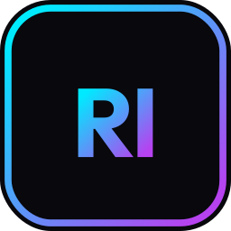
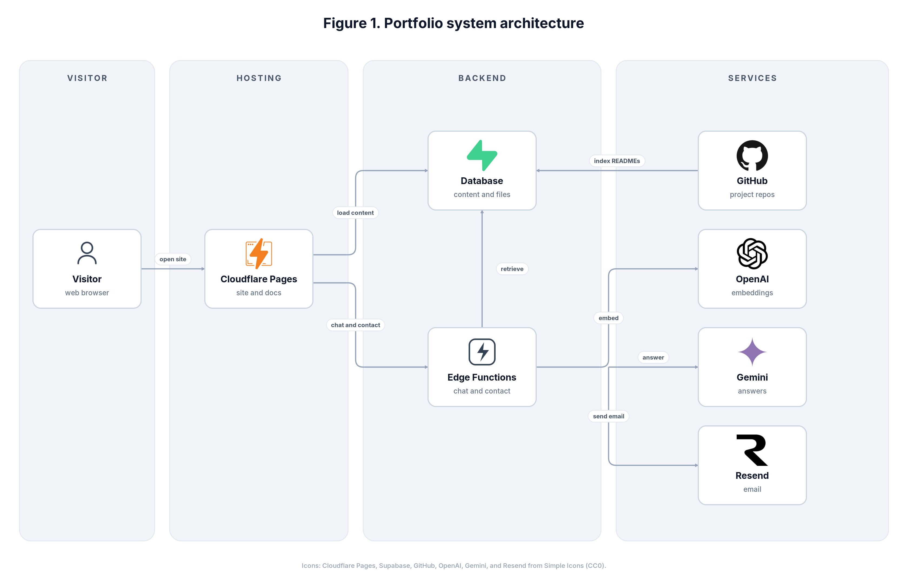

  

<h1 align="center">Ritvik Indupuri</h1>

<b>A cybersecurity portfolio of projects, writing, and tools</b>

  <a href="https://ritvik-portfolio.pages.dev">https://ritvik-portfolio.pages.dev</a>

## Overview

This is my public portfolio. It presents my background, experience, skills, and certifications, along with projects in cloud, container, and AI security. Visitors can read technical documentation, download a resume, ask a chatbot about the work, or send a message through the contact form.

The site is hosted on Cloudflare Pages. Page content and resume files are loaded from Supabase. Documentation PDFs are served from the site itself.

## Key Features

- **Portfolio content.** About, skills, experience, certifications, and a resume that can be viewed or downloaded. This material is loaded from the content database and file storage.
- **Projects.** Featured work plus boards for Security Engineering, Cloud Security, Container and Kubernetes Security, and AI and Cybersecurity, with links to GitHub and project documentation.
- **Agentic Security Systems.** A showcase of agent-based security projects, including descriptions, feature lists, and architecture views.
- **Security Tools.** Shipped tools that can be tried or installed, including AgentPot and related skills.
- **Technical documentation.** Featured write-ups that open as PDFs in a new tab.
- **Portfolio chatbot.** Questions are answered from current portfolio content. The backend embeds the question, retrieves the closest matching material (including indexed GitHub READMEs), and writes a reply with Gemini.
- **Contact form.** Name, email, and message are sent through a backend function and delivered by email.

## System Architecture

The diagram shows how a visit reaches the site, the content store, and the chat and contact services.

  

1. A visitor opens the site on Cloudflare Pages, which serves the portfolio and the technical documentation PDFs.
2. The site loads profile, skills, experience, projects, certifications, documentation listings, and resume files from the Supabase database and storage.
3. Project cards link out to their GitHub repositories. When project records change, a backend function can index those README files into the database so the chatbot can search them later.
4. Chat questions go to an Edge Function. The function embeds the question with OpenAI, searches stored portfolio content, and sends the question plus the retrieved context through an AI gateway that runs Gemini.
5. The contact form goes to an Edge Function, which delivers the message by email through Resend.
